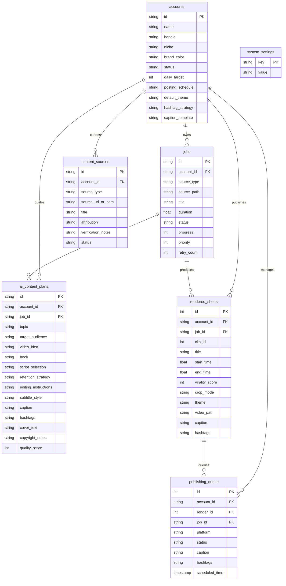

# VedioHooks AI Media Factory — Architecture Specification

**System Architecture:** Multi-Account, Local-First, 24/7 Autonomous AI Media Factory  
**Execution Platform:** Windows 11 AMD64 | Python 3.14.6 | FFmpeg 9.0.2  
**Database:** SQLite 3 (WAL Mode) with Complete Multi-Account Data Isolation  

---

## 1. System Architecture Overview

The system is designed as a modular, local-first media factory and content engine that operates continuously without recurring costs or mandatory cloud subscriptions. All AI inference (speech transcription, MediaPipe face tracking, multi-dimensional virality heuristics, 14-point strategic content plans) runs directly on the local machine.

```mermaid
flowchart TD
    subgraph MultiAccount ["1. Multi-Account Network & Sources"]
        Acc1["Account: Motivation (@stoic)"]
        Acc2["Account: Cricket (@cricket)"]
        Acc3["Account: AI & Study (@aistudy)"]
        Acc4["Account: Gym & Fitness (@iron)"]
        Acc5["Account: Common / General (@curiosity)"]
        CS["Content Discovery Sources (YouTube / RSS / Keywords)"]
        CS --> Acc1 & Acc2 & Acc3 & Acc4 & Acc5
    end

    subgraph AIDirector ["2. AI Content Director (14-Point Blueprint)"]
        DP["Niche Personality & Retention Strategy Engine"]
        DP --> BP["14-Point Strategic Blueprint (Hook, Audience, Script, Quality Score)"]
    end

    subgraph Ingestion ["3. Media Ingestion & Speech"]
        A[YouTube URL / Local Video Upload] --> B[yt-dlp Ingestion Engine]
        B --> C[16kHz Mono WAV Extraction - FFmpeg]
        C --> D[Faster-Whisper Model Singleton]
        D --> E[Word-Level Millisecond Timestamps JSON]
    end

    subgraph Virality ["4. Virality Scoring & NMS"]
        E --> F[Multi-Dimensional Virality Scorer]
        F --> G[Opening Hook, Curiosity Gap, Cadence, Emotion]
        G --> H[Non-Maximum Suppression (NMS) Filter]
        H --> I[Viral Highlights & Quote Selections]
    end

    subgraph Rendering ["5. Visual Framing & Subtitles"]
        I --> J[MediaPipe Face Tracker Singleton]
        J --> K[Dynamic Focal Center Coordinates X]
        K --> L[Alex Hormozi Karaoke Subtitle Generator (.ass)]
        L --> M[Single-Pass 9:16 FFmpeg Lanczos Crop + ASS Burn + Loudnorm]
        M --> N[Rendered 1080x1920 Short MP4]
    end

    subgraph Orchestration ["6. 24/7 Scheduler & Emergency Stop"]
        O[(SQLite Database - jobs.db)]
        P[24/7 Autonomous Scheduler Daemon]
        ES["Emergency Stop Master Switch (Global Kill)"]
        Q[Crash Recovery & Interrupted Job Resumption]
        ES --> P
        P <--> O
        P --> Ingestion
        P --> Rendering
    end

    subgraph Publishing ["7. Publishing & Commercial SaaS Dashboard"]
        N --> R[Publishing Queue (Drafts / Approved States)]
        R -.-> S[Official Meta Instagram Graph API v19.0 Client]
        T[FastAPI Server & HTTP 206 Video Streaming]
        U[Commercial SaaS Dashboard - 12 Operational Views]
        O <--> T
        T <--> U
    end
```

---

## 2. Core Subsystems & Responsibilities

### 2.1 Multi-Account Instagram Architecture (`src/db.py`)
- Complete data isolation for 5 specialized niches (Motivation, Cricket, AI & Study, Gym & Fitness, General).
- Dedicated account properties:
  - Unique handle, brand color hex, daily target output.
  - Custom posting schedules and posting windows.
  - Custom caption templates with dynamic `{hook}`, `{punchline}`, and `{hashtags}` placeholders.
  - Custom subtitle theme preset defaults (`hormozi_yellow`, `hormozi_green`, `cyber_cyan`, `beast_red`, `clean_minimal`).
  - Active/Paused operational status.

### 2.2 Content Discovery & Compliance Pipeline (`src/db.py`, `src/server.py`)
- Content source registry supporting YouTube channels, RSS feeds, search keywords, and curated links.
- Mandatory compliance checks:
  - **Cricket Niche:** Requires verified statistics and match facts (strict safeguard against fabricated records) with sports fair-use commentary disclaimers.
  - **Gym & Fitness Niche:** Mandatory exercise safety cues with non-medical advice disclaimers.
  - **Attribution & Copyright:** Explicit source credit tracking.

### 2.3 AI Content Director — 14-Point Strategic Blueprints (`src/ai_director.py`)
- Deterministic, 100% free offline heuristic engine generating comprehensive blueprints:
  1. **Topic & Narrative Angle**
  2. **Target Audience Profile**
  3. **Video Concept & Angle**
  4. **Viral Opening Hook (First 1–3s)**
  5. **Script Selection / Quotation**
  6. **Optimal Clip Timestamps (Start/End)**
  7. **Retention Tactics (e.g. contrast cuts, fast cadence)**
  8. **Editing & Pacing Rules**
  9. **Subtitle Theme Selection**
  10. **High-Converting Caption**
  11. **Targeted Hashtag Cluster**
  12. **Cover Text Template**
  13. **Rights, Verification & Compliance Notes**
  14. **Virality Quality Score (0–100 Gauge)**
- Optional cloud LLM enhancement (Gemini 2.5 Flash / OpenAI GPT-4o) when API keys are configured.

### 2.4 Media Ingestion & Speech Transcription (`src/ingest.py`, `src/transcribe.py`)
- Downloads web video using `yt-dlp` targeting 1080p MP4.
- Extracts 16kHz mono 16-bit linear PCM WAV with duplicate audio extraction prevention.
- Runs Faster-Whisper using CPU INT8 quantization across 12 hardware threads with Voice Activity Detection (VAD).
- Employs a thread-safe singleton cache (`_MODEL_CACHE`) to eliminate repeated model weight loading.

### 2.5 Visual Framing & Subtitle Engine (`src/face_tracker.py`, `src/subtitle_generator.py`, `src/video_slicer.py`)
- MediaPipe Face Detection tracks speaker positions; median filter stabilizes coordinates.
- Single-pass FFmpeg rendering applies Lanczos scale & crop to 1080x1920 9:16 vertical video.
- Alex Hormozi animated karaoke subtitles with safe margin preservation (`margin_v=720`).
- EBU R128 audio loudness normalization (`-af loudnorm`).

### 2.6 24/7 Autonomous Scheduler & Emergency Controls (`src/scheduler.py`, `src/db.py`)
- SQLite persistent job queue with exponential backoff retries.
- Automatic startup recovery resets interrupted in-flight jobs to `queued` on system boot.
- Master Emergency Stop switch immediately blocks new job creation (HTTP 423) and halts background rendering.

### 2.7 Official Meta Instagram Graph API (v19.0+) Integration (`src/publishing.py`)
- Zero-Scraping / Zero-Browser-Automation guarantee.
- Draft / Approved / Scheduled / Published state machine.
- Publishing remains disabled by default; requires manual human approval before posting.
- Dry-run simulator verifies payload structure and character limits.

---

## 3. Database Schema



---

## 4. Operational Dashboard Architecture (Single-Page App)

The Commercial SaaS Dashboard provides 12 dedicated views built with responsive dark-mode styling, glowing accents, and high-density telemetry:
1. **Overview:** Global operational KPI cards, 5-account network grid, recent renders showcase.
2. **Account Manager:** Full account lifecycle (create, update, pause, resume, delete).
3. **Content Discovery:** Channel, RSS, and keyword ingestion with compliance notes.
4. **AI Content Director:** On-demand 14-point blueprint generator & history log.
5. **Video Factory:** Dual URL / File upload ingest with face tracking mode & subtitle theme selector.
6. **Video Library:** Rendered vertical shorts gallery with HTML5 Range video streaming and download.
7. **Publishing Calendar:** Instagram draft review, caption/hashtag editing, and manual approval toggle.
8. **Instagram Graph API:** Official Meta API configuration, permissions status, and dry-run simulator.
9. **Analytics:** Hook retention distributions, virality averages, and daily production cadence.
10. **Automation Centre:** 24/7 background scheduler controls, concurrency manager, emergency stop status.
11. **System Health:** Hardware telemetry gauges (CPU, RAM, Disk, Workers) and job lifecycle actions.
12. **Settings:** Storage cleanup tools, cache clearance, and engine configuration.
